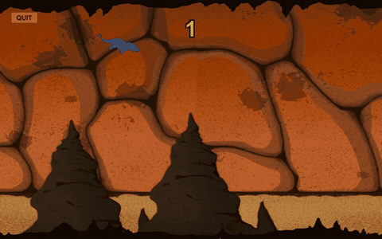

# Flappy Dragon 🐉

Flappy Dragon is a 2D game developed in Unity using C#. I created this project in 2021, while learning game development. 

The game is inspired by Flappy Bird, with a dragon as the main character.

## Gameplay

  
  

Players control a flying dragon, avoid obstacles and collect eggs. The game includes different difficulty settings.

## Technologies

- Unity
- C#
- 2D game development
- Sprite animation

## My Contributions 

- Drew and animated the game's graphics myself. 🎨
- Designed and developed the game in Unity.
- Implemented gameplay mechanics using C#.
- Worked with collision detection, scoring and difficulty settings.

## About the Project

This is one of my earlier game development projects. Previous to this project I had no experience with programming, but this is one of the projects that made me want to learn C# later on. It gave me practical experience with Unity, C# programming, animation and game design. During development, I used online programming resources, including Stack Overflow, as learning references. The project was developed without the use of AI. 

### Notes

This game was originally developed in 2021. The sound effects were replaced in 2026 with CC0-licensed alternatives. The original gameplay and code remain unchanged.
