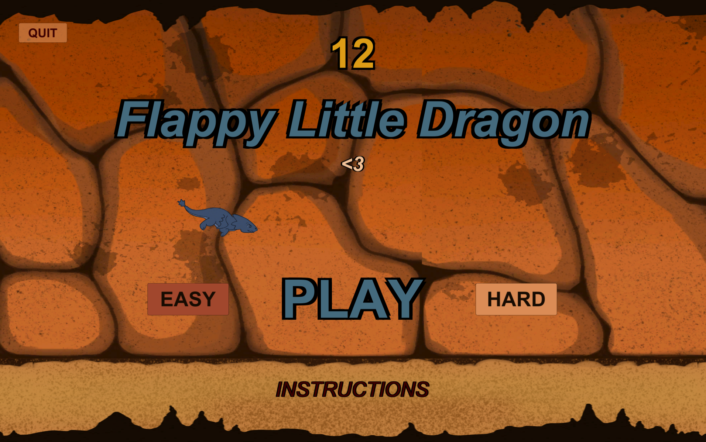

# Flappy Dragon 🐉

Flappy Dragon is a 2D game developed in Unity using C#. I created this project in 2021, while learning game development. 

The game is inspired by Flappy Bird, with a dragon as the main character.

## Gameplay

  
  

Players control a flying dragon, avoid obstacles and collect eggs. The game includes different difficulty settings.

## Technologies

- Unity
- C#
- 2D game development
- Sprite animation

## My Contributions 

- Drew and animated the game's graphics myself. 🎨
- Designed and developed the game in Unity.
- Implemented gameplay mechanics using C#.
- Worked with collision detection, scoring and difficulty settings.

## About the Project

This is one of my earlier game development projects. Before this project, I had no programming experience. It was one of the projects that inspired me to continue learning C#. It gave me practical experience with Unity, C# programming, animation and game design. During development, I used online programming resources, including Stack Overflow, as learning references. The project was developed without the use of AI. 

## How to Run

1. Clone or download this repository.
2. Open the project in Unity Hub.
3. Use Unity **2020.3.49f1**, as specified in `ProjectSettings/ProjectVersion.txt`.
4. Open the scene `Assets/Little dragon.unity`.
5. Press **Play** to start the game.

**Note:** The game was originally developed in Unity 2020.3.22f1.

## Notes

This game was originally developed in 2021. The sound effects were replaced in 2026 with CC0-licensed alternatives. The original gameplay and code remain unchanged.
